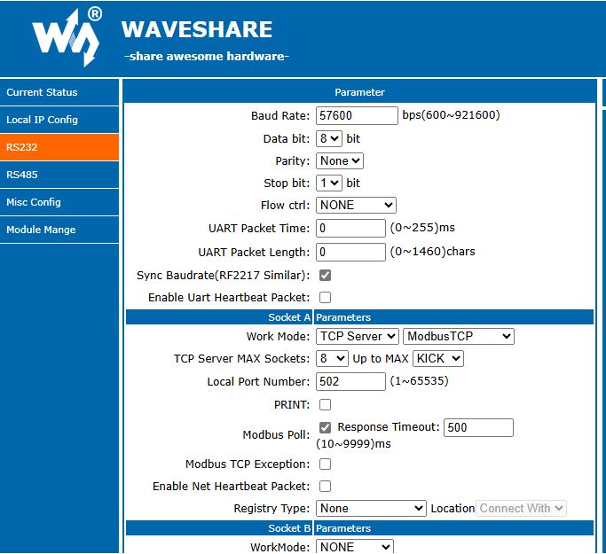
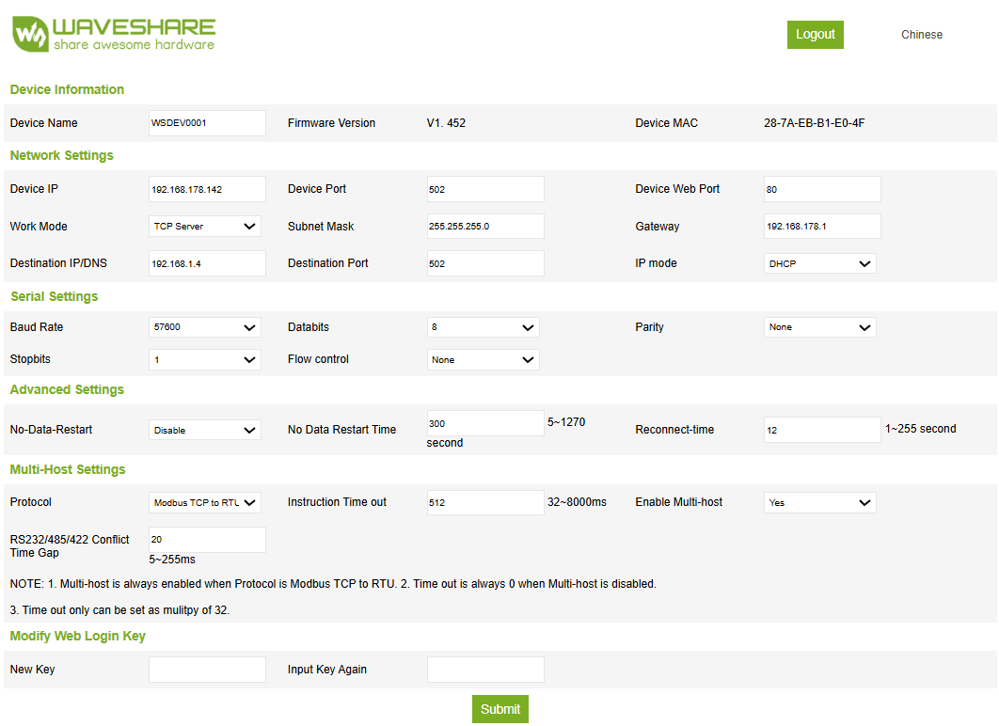

# Froeling Lambdatronic Modbus

Home Assistant integration for Fröling Lambdatronic heating systems via Modbus. Currently supports Modbus TCP via a Serial‑to‑Ethernet bridge.

## 🚀 Features

With this integration, you can:

- Read real-time sensor data from your Fröling system (temperatures, states, pump speeds, consumption, etc.).
- Monitor boiler operation (e.g., Kesselzustand, Anlagenzustand).
- Configure parameters via writable Number entities, using input boxes.
- Control modes via Select entities (e.g., HK01/HK02 Betriebsart with Aus/Automatik/Extraheizen/Absenken/Dauerabsenken/Partybetrieb).
- Inspect the boiler error buffers.

---

## 💻 Requirements

You need a Modbus-to-TCP device. This integration has been tested with the Waveshare RS232/RS485 to Ethernet Converter; other Serial-to-Ethernet adapters should work.

The integration uses Home Assistant's built-in Modbus connection manager, so integrations configured with the same TCP connection can share and serialize access to the device.

> ⚠️ **Important – RS232 & Nullmodem cable required**
>
> Fröling Lambdatronic systems communicate via **Modbus RTU over RS232** on **COM2**.
>
> - ❌ **RS485-only adapters will NOT work**
> - ✔ You must use an **RS232-capable Serial-to-Ethernet converter**
> - 🔁 A **nullmodem (crossed) RS232 cable** is required (direct / straight RS232 cables will not work)

### 🔧 Enabling Modbus RTU on the Boiler

To enable Modbus RTU on your Fröling boiler:

1. Click the user icon and enter code `-7`.
2. Adjust the following settings:
   - **Settings > General Settings > MODBUS Settings > Modbus Protokoll RTU** → `Set to 1`
   - **Settings > General Settings > MODBUS Settings > Use Modbus Protokoll 2014** → `Yes`
   - **Settings > General Settings > MODBUS Settings > Use COM2 as MODBUS Interface** → `Yes`

---

## 🛠️ Hardware Setup

Use a Serial-to-Ethernet converter between the boiler’s COM2 and your network.

### Example 1: Waveshare RS232/RS485 to Ethernet Converter

- Converter connected via RS232 to COM2 on the boiler.
- Example configuration screenshot:

  

### Example 2: Waveshare RS232/485/422 TO POE ETH (B) Converter

- Converter connected via RS232 to COM2 on the boiler.
- Example configuration screenshot:

  

Other Serial-to-Ethernet converters should also work.

If you're looking for a way to power your Serial Ethernet converter directly from your Fröling board, check this out:
[Power Supply](docs/power_supply.md)

---

## 📦 Installation

### HACS (recommended)

- Ensure [HACS](https://hacs.xyz/) is installed.
- Search for “Froeling Lambdatronic Modbus” and install.
- Restart Home Assistant.

### Manual

- Download the latest release from: https://github.com/GyroGearl00se/ha_froeling_lambdatronic_modbus/releases
- Copy custom_components/froeling_lambdatronic_modbus into your Home Assistant custom_components folder.
- Restart Home Assistant.
- Add the integration via the Home Assistant UI.

---

## 🛠️ Setup

1. Settings → Integrations → “+ Add Integration”.
2. Select “Froeling Lambdatronic Modbus”.
3. Fill out the form:
   - Device name (Default: Froeling)
   - Hostname/IP of your Modbus TCP device
   - Port (Default: 502)
   - Update Interval (Default: 60s)
   - Select installed components on your unit:
     - Kessel (Boiler)
     - Fehlerpuffer (Error Buffer)
     - Boiler 01 (DHW Boiler)
     - Heizkreis 01 (Heating Circuit)
     - Heizkreis 02 (Heating Circuit)
     - Austragung (Feed System)
     - Puffer 01 (Buffer)
     - Zirkulationspumpe (Circulation Pump)
     - Zweitkessel (Second Boiler)
4. Submit and wait for entities to appear.

---

## 📊 Entities Overview

- Sensors:
  - Temperatures (e.g., Kesseltemperatur, Abgastemperatur, HK Vorlauf), loads, consumption, etc.
- Text Sensors:
  - Anlagenzustand, Kesselzustand (mapped from numeric states).
  - Boiler error buffers (20 slots)
- Numbers:
  - Writable setpoints and parameters (e.g., Kessel_Solltemperatur).
  - Proper step sizes and input box UI.
- Selects:
  - Betriebsart for heating circuits (e.g., HK01/HK02), options: Aus, Automatik, Extraheizen, Absenken, Dauerabsenken, Partybetrieb.

## 🧩 Visualization

- Lovelace: Checkout the Fröling Card (HACS): https://github.com/GyroGearl00se/lovelace-froeling-card
- Example:
  

## 🧡 Contributing

Contributions are welcome!

1. **[Fork this repository](https://docs.github.com/en/get-started/quickstart/fork-a-repo).**
2. Make changes within your fork.
3. **[Create a pull request](https://docs.github.com/en/pull-requests/collaborating-with-pull-requests/proposing-changes-to-your-work-with-pull-requests/creating-a-pull-request).**

I’ll do my best to review and merge contributions.

---

## Disclaimer

This project is not affiliated with or endorsed by Fröling. All trademarks are property of their respective owners.
